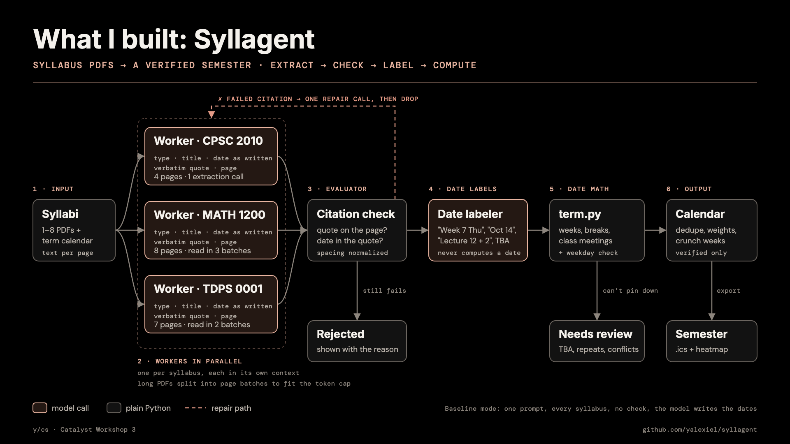

# Syllagent

**Live demo:** https://syllagent.streamlit.app

Upload course syllabi (PDFs). It finds every deadline, exam and graded item, proves each one against the PDF text, works out dates like "Week 7 Thursday" or "two days after Lecture 8", shows which weeks are crunch weeks, and exports an `.ics` file.

**Who it's for:** a student taking four or five courses. Each syllabus is a PDF with its own format, and the dates hide in prose and tables ("Week 7 Thu", "the day after Lecture 12", "TBA"). Copying them into a calendar by hand takes an hour and is easy to get wrong, and the week where three midterms land at once usually shows up too late. Asking a chatbot is faster but it invents dates with confidence, which is worse than no date. This tool only puts a date on your calendar when it can show you the sentence it came from.

Plain Python and Streamlit, with model calls through the OpenAI SDK's Responses API. There's no agent framework.



## Run it

You need Python 3.10 or newer.

**1. Install (once)**

```sh
python3 -m venv .venv
source .venv/bin/activate
pip install -r requirements.txt
cp .env.example .env
```

**2. Add `GROQ_API_KEY` to `.env`.** Get one at [console.groq.com](https://console.groq.com/keys); it starts with `gsk_`. Groq (with a q) is not xAI's Grok. Never commit `.env`.

**3. Start the app**

```sh
streamlit run app.py
```

Open the URL Streamlit prints. Next time, run only `source .venv/bin/activate` and step 3.

The model is `openai/gpt-oss-120b` on Groq. To switch providers, change `BASE_URL`, `MODEL` and `API_KEY_ENV` in `syllabus_agent/config.py`; for xAI Grok that's `https://api.x.ai/v1` and `XAI_API_KEY`. Check the connection with `python -m syllabus_agent.smoke`.

## How it works

| Step | Pattern | What happens |
| --- | --- | --- |
| 1 · Extract | Orchestrator–workers, parallel | One worker per syllabus, each with its own context. It returns items with the date exactly as written, a verbatim quote and a page number. At most 3 model calls per worker, except that on Groq's free tier a long syllabus is read in batches of pages so each call has room to answer. |
| 2 · Citation check | Evaluator | Plain Python normalizes the PDF text and the quote (hyphenated line breaks, ligatures, smart quotes) and checks that the quote is on the cited page and contains the date. A failure goes back to the worker once, with the reason. Then it's dropped. |
| 3 · Dates | Model parses, code computes | The model only labels each date: absolute, week + weekday, nth class meeting, a range, or unresolvable. `term.py` does the arithmetic from the term calendar: weeks start at the term start, class meetings skip breaks, and dates without a year get the right one across New Year. Anything it can't pin down goes to **Needs review** instead of the calendar. |
| 4 · Load | | Weights come from the syllabus or are inferred from the grading breakdown ("30%, 6 sets, lowest dropped" → 6% each). Weekly totals feed the heatmap. The 3 heaviest weeks, and any week with 2+ exams, are crunch weeks. |

**Term calendar:** `syllabus_agent/term.yaml` holds placeholder dates. Fill it in from your school's official calendar, or edit it in the sidebar. **Load demo term** loads the fictional term that matches the demo syllabi.

**Groq free tier:** it allows 8,000 tokens per minute. A live run on all five demo syllabi takes about 2 minutes, mostly waiting, and the trace shows each wait. The baseline only fits at low reasoning effort, and the page says so. After upgrading to a paid tier, set `TOKENS_PER_MINUTE = None` in `config.py`.

## 90-second demo script

The app ships with one recording: a real verified run over five real Fall 2026 syllabi (CPSC 2010, MATH 1200, MATH 2250, MATH 2410, TDPS 0001). Replaying it needs no API key or network. Before going on stage, open the app and check that **Replay the demo** plays.

1. **The problem (10 s).** Five syllabi, five formats, dates like "Week 7 Thu" buried in prose and tables. Asking a chatbot invents dates with confidence.
2. **Replay (10 s).** Click **Replay the demo** on the landing page. It's a real run over five real syllabi, played back, and it loads the term calendar that run used.
3. **Workers and a rejected citation (20 s).** Five workers run side by side. Point at MATH 2410's red ❌: the model wrote "weeks of Oct. 12", but the syllabus says "the weeks of Sept. 28, Oct. 12, and Nov. 30". The date isn't in the text, so the check rejects it after one retry. Nothing reaches the calendar without a quote that's really on its page.
4. **Live run (20 s).** With the replayed term still loaded, upload `MATH 2250 syllabus.pdf` (two pages) and press **Run**: one worker, about 10 seconds, the same result as the recording.
5. **Evidence (10 s).** Click the MATH 1200 *Midterm Exam 1* row: the quote, page 4, and the date computed by code (**Thu Oct 1**). Open *Needs review*: "Thurs. Dec. 15" is a Tuesday, so a person decides. Download the `.ics`; every event carries its quote and page.
6. **Crunch weeks (5 s).** Week 11 (Nov 9–15): two midterms plus a response paper.
7. **Eval and limitations (15 s).** Scroll to the bottom. On relative dates the single prompt gets 5–11 of 39 wrong across four runs; the pipeline 39 of 39. On real syllabi with written-out dates they tie, and the pipeline's edge is provenance. Then name one limitation: the TDPS seminar title that became a calendar item.

To run the baseline live instead: toggle *Use the 5 demo syllabi*, click **Load demo term**, and run both modes (about 4 minutes); the comparison table appears under the results.

**Read the results carefully:** the check proves a quote is on the page, not that the model labeled it correctly. The answer key exists only for the demo syllabi. For your own PDFs, the baseline is scored against the verified pipeline, which shows disagreement, not ground truth.

## Evaluation

Recorded runs in `evals/`, scored against hand-checked answer keys with `python -m syllabus_agent.evaluate` (no API calls). The app shows the same tables at the bottom of the page.

**Synthetic syllabi** (five generated syllabi full of relative dates, `tests/fixtures/syllabi/`):

|  | Verified pipeline (1 run) | Single-prompt baseline (4 runs) |
|---|---|---|
| Correct dates | 39 of 39 | 24, 30, 26, 25 of 39 |
| Wrong dates | 0 | 11, 5, 9, 10 |
| Reference items missed | 0 | 4 |
| Cited text not in the PDFs | 0 | 4, 4, 35, 19 |
| Sent to review instead of guessing | 2 | 0 |

**Real syllabi** (five real Fall 2026 syllabi, mostly absolute dates; the key is `evals/real-answer-key.json`):

|  | Verified · all 5 syllabi | Verified · CPSC 2010 + MATH 2250 | Baseline · CPSC 2010 + MATH 2250 |
|---|---|---|---|
| Correct dates | 20 of 20 | 5 of 5 | 5 of 5 |
| Wrong dates | 0 | 0 | 0 |
| Reference items missed | 0 | 0 | 0 |
| Extra items (not graded) | 1 | 0 | 0 |
| Sent to review | 5 | 2 | 0 |

What this shows: when dates are written relative to the term ("Week 7 Thu", "Lecture 12 + 1 day"), a single prompt gets 5 to 11 of 39 wrong and cites text that isn't in the PDFs; the pipeline got all 39. When dates are written out ("Tuesday Oct 13"), the baseline does about as well on dates, and the pipeline's advantage is that every item carries a verified quote and page, and undatable items (TBD, weekly, a self-contradicting weekday) go to review instead of being guessed. The baseline is compared on two real syllabi only because one prompt with all five is over Groq's free-tier per-minute limit.

## Limitations

- **Recall depends on the model.** The citation check proves every calendar item is real; it can't prove nothing was missed. A rerun can drop a minor item (MATH 2250's weekly homework once).
- **A real quote can still be mislabeled.** TDPS's "Oct. 12: Homework for the Live Event" is a seminar title, not an assignment, but the quote is genuine, so it reached the calendar: the one extra item above.
- **Conservative by design.** A paraphrased date ("weeks of Oct. 12") is rejected rather than fixed, and repeating items ("every Wednesday") go to Needs review rather than becoming weekly events.
- **Free-tier limits.** 8,000 tokens a minute: five syllabi take about 5 minutes, long PDFs are read in page batches, and the baseline can't take all five real syllabi in one prompt.
- **A small eval.** One verified run per set, ten syllabi, answer keys written by the builder.
- **Inputs.** No OCR (scanned PDFs are skipped), the term calendar is entered by hand, and weights marked ~ are inferred when a syllabus doesn't state one.

## Project layout

```text
app.py                  starts the app
syllabus_agent/
  config.py             provider, model, key name, token limits, default weights
  pdfs.py               text per page; scanned PDFs are skipped
  agents.py             extractor workers, repair, date parsing, baseline
  citations.py          the citation check (plain Python)
  term.py               term calendar and all date arithmetic
  load.py               resolve, dedupe, infer weights, crunch weeks
  charts.py, export.py  heatmap and .ics
  compare.py            scores a run against the answer key
  evaluate.py           the evaluation tables, from recorded runs (no API calls)
  page.py               live trace, results, replay, comparison
  term.yaml             placeholder term: fill in from your school's calendar
  architecture.svg/.png the diagram above (render the PNG from the SVG with headless Chrome)
  runs/                 the recorded demo run (every completed live run is saved here)
evals/                  recorded verified and baseline runs + the real syllabi's answer key
tests/
  test_syllabus_agent.py
  fixtures/             synthetic syllabi, demo term and answer key (make_syllabi.py)
```

## Tests

```sh
python -m unittest discover -s tests -v
```

The tests run the real fixture PDFs through a scripted fake model, so they cost nothing and need no API key. Rebuild the fixtures with `python tests/fixtures/make_syllabi.py`.

## Links

[Building effective agents](https://www.anthropic.com/engineering/building-effective-agents) · [Groq Responses API](https://console.groq.com/docs/responses-api) · [iCalendar (RFC 5545)](https://datatracker.ietf.org/doc/html/rfc5545)
